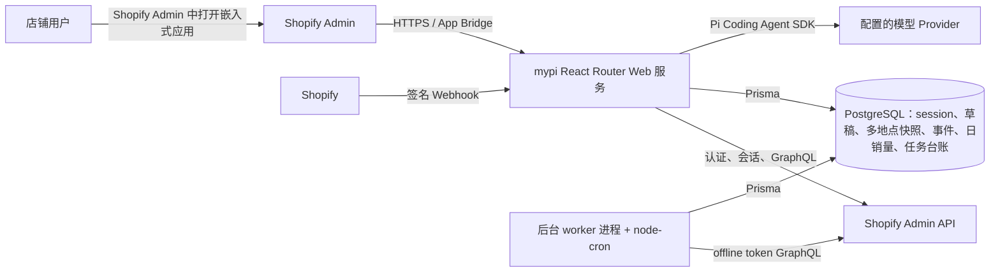
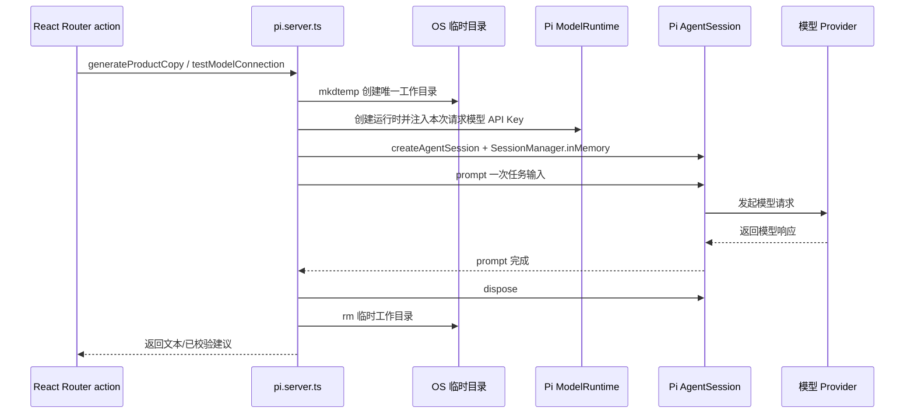
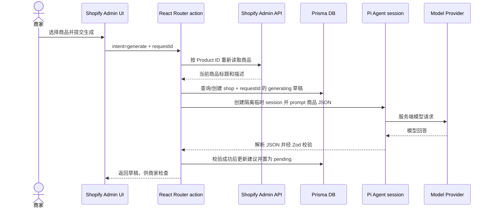
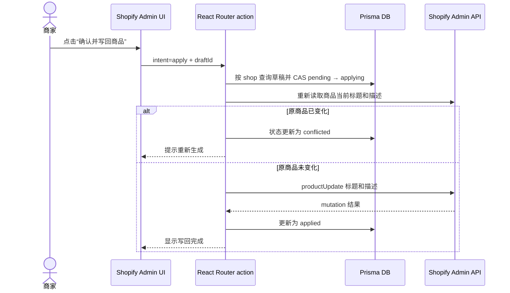
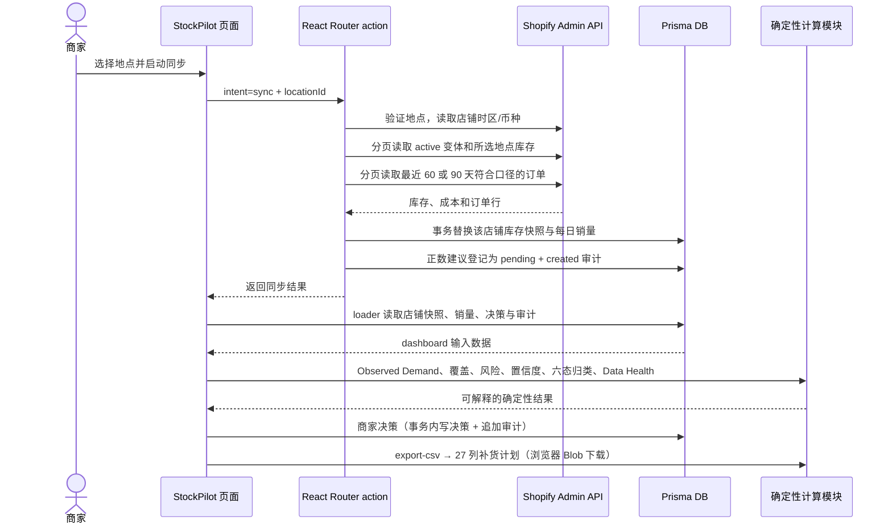

# my-pi 技术架构与部署设计

> 文档基线：2026-10-31。本文描述仓库当前实现，并明确区分当前开发/测试形态与生产部署目标。Shopify App 的“安装”是将应用授权给店铺，并不代表应用服务器代码运行在 Shopify 内部。

## 1. 产品与系统边界

my-pi 是 Shopify Admin 中运行的嵌入式应用。当前商家界面聚焦 StockPilot 库存诊断；AI 商品文案功能保留在代码中但默认隐藏。StockPilot 读取商品、库存和订单数据，使用确定性算法计算库存健康与补货建议，商家可以持久化补货决策状态，但不会自动修改 Shopify 数据。

核心设计约束：

- 一个应用服务可供多个 Shopify 店铺安装；店铺是业务数据、草稿和未来店铺级 Agent 配置的租户边界。
- Shopify 用户会话用于认证用户和访问 Admin API，不是 Pi Agent 会话或 Agent Memory。
- 产品概念上可定义为“一店铺一个逻辑商品文案 Agent”。当前并不创建常驻 Agent：每次模型任务创建一次性 Pi session，任务结束即释放。
- 当前所有店铺共用服务器侧的 Provider、Model 和 API Key 配置；尚无商家 BYOK 或按店铺单独模型配置。
- 模型负责产生建议，不负责决定是否写回 Shopify。生成和写回是两个独立、由用户确认的阶段。
- StockPilot 的销量、库存风险和采购数量由服务端确定性逻辑计算；AI 不参与库存决策。

## 2. 系统上下文与部署拓扑



应用服务是独立的 Node.js 服务：

- Shopify Admin 提供后台入口和嵌入式容器。
- React Router 服务负责页面、服务端 loader/action、OAuth 回调和 Webhook。
- Shopify Admin API 保存和读取实际商品数据。
- Prisma 数据库保存 Shopify OAuth session（offline token）、文案草稿及按店铺隔离的 StockPilot 设置、地点目录、每日库存快照、库存变化事件、同步任务台账和每日销量。
- 后台 worker 是独立进程，只读 Shopify、不开放 HTTP 入口；靠 `DataSyncJob` 台账与 `hasRunningJob` 避免同店同类任务并发重跑。
- Pi SDK 在 Web 服务进程内执行；模型请求从服务端发往模型 Provider。

### 当前开发/测试拓扑

```text
开发者 Mac
  ├─ Shopify CLI：npm run dev
  ├─ Node.js / React Router 本地服务
  ├─ Shopify CLI 临时 HTTPS tunnel
  ├─ PostgreSQL（云端 Supabase，连接串写在 `.env` 的 `DATABASE_URL`）
  └─ 服务端环境变量：SHOPIFY_*、DATABASE_URL、PI_API_KEY、PI_PROVIDER、PI_MODEL
                    │
                    ├─ Shopify Admin / Admin API
                    └─ 模型 Provider
```

开发隧道用于让 Shopify 回调访问本机。它不是生产主机，地址可能变化，也不适合稳定接收生产 Webhook。

### 数据库连接端点的选择

Supabase 同一个项目提供几类端点，选错会直接表现为 Prisma `P1001 Can't reach database server`：

| 端点 | 形态 | 协议族 | 适用 |
| --- | --- | --- | --- |
| 直连 | `db.<ref>.supabase.co:5432`，用户 `postgres` | **仅 IPv6**（只有 AAAA 记录），除非购买 IPv4 add-on | 有 IPv6 出口的持久后端；迁移 / `pg_dump` 等单会话原生命令 |
| Shared pooler · session | `aws-<index>-<region>.pooler.supabase.com:5432`，用户 `postgres.<ref>` | IPv4 | **本项目本地开发**；IPv4-only 网络；BI / GUI 工具 |
| Shared pooler · transaction | 同上主机，端口 `6543` | IPv4 | serverless / edge function；需给 Prisma 加 `pgbouncer=true` |

本项目的 `.env` 使用 **session pooler**。原因：开发机没有 IPv6 默认路由（`route -n get -inet6 default` 查不到 gateway），而直连主机只发布 AAAA 记录，属于**结构性连不通**，与本机代理软件无关；同一项目的 HTTPS 端点有 Cloudflare 的 A 记录，所以 `curl` 一直正常，容易被误判成「只有数据库挂了」。

注意事项：

- `?sslmode=require` 必须保留，Supabase 强制 SSL。
- pooler 主机名**不能由区域名自行拼凑**：`<index>` 是池集群序号，必须从 Dashboard 的 Connect → Session pooler 复制；用户名也要从 `postgres` 改为 `postgres.<ref>`。
- session mode 支持 prepared statements，Prisma 无需 `pgbouncer=true`。transaction mode 不支持，并且每笔事务结束即归还连接，会丢弃 session 级状态（`set`、session advisory lock、`with hold` cursor、pipelining），与 `app/inventory.server.ts` 里的交互式事务冲突。
- session mode 的最大连接数受 Dashboard「Database Settings → Connection pooling → Pool Size」限制，且**按 (role + database) 组合各算一份**。dev server + worker + 验收同时跑时若报 `Max client connections reached`，应在连接串上收紧 `connection_limit`（Prisma 默认开 `num_cpus × 2 + 1` 个连接），而不是调大 `pool_timeout`。
- 不建议为 IPv4 开启 IPv4 add-on：它不是 dual-stack，开启后会把项目的 AAAA 记录**换成** A 记录，影响已依赖 IPv6 的路径。
- 判据优先级：先查端点协议族（`dig +short A <host>` 为空而 `dig +short AAAA <host>` 有值），再查代理拦截。`nc -z <host> 5432` 报 succeeded **不能**当作数据库可用，要判定就得真发一条 SQL（如 `prisma migrate status`）。

### 生产目标拓扑（尚未完成）

```text
Shopify Admin
   │ HTTPS
   ▼
具备公网 HTTPS 的 Node.js 应用托管平台
   ├─ React Router Web 服务（一个或多个实例）
   ├─ 共享、持久化的关系型数据库（已就位：PostgreSQL）
   ├─ 平台 Secret 管理（Shopify 与模型凭据）
   ├─ 日志、错误告警、健康检查与备份
   └─ 出站 HTTPS ──> 模型 Provider
```

代码由开发者部署到外部应用托管平台；Shopify 保存应用注册、安装授权和 Admin 数据。多实例部署要求数据库、会话和草稿存储都由实例共享，不能依赖某个进程的本地文件系统。

## 3. 技术栈与运行时

| 子系统 | 当前实现 |
| --- | --- |
| 语言与运行时 | TypeScript；Node.js `>=22.19.0` |
| Web 服务 | React 18、React Router 7、Vite 7 |
| Shopify 应用接入 | `@shopify/shopify-app-react-router`、Shopify App Bridge、Shopify Web Components (`s-*`) |
| Shopify API | Admin GraphQL API，版本 `2026-10` |
| 身份与会话 | Shopify OAuth/session；`useOnlineTokens: false`（offline token，供 worker/webhook/定时任务使用）；Prisma session storage |
| 数据访问 | Prisma 6；PostgreSQL，保存 OAuth session、商品文案草稿、StockPilot 设置、地点目录、每日快照、库存事件、任务台账和每日销量 |
| 后台调度 | 独立 Node worker（`worker/index.ts`）+ node-cron，esbuild 打包 |
| AI Agent SDK | `@earendil-works/pi-coding-agent` 1.4.0 |
| 模型输出校验 | Zod 4 |
| 本地开发及应用配置 | Shopify CLI；`shopify.app.toml`、`shopify.web.toml` |
| 自动化测试 | Node.js `node:test`，通过 Node 24 TypeScript 类型转换执行 |

生产构建入口为 `npm run build`，服务启动命令为 `npm run start`。`npm run setup` 执行 Prisma Client 生成和已发布迁移；开发时 Shopify CLI 根据 `shopify.web.toml` 的命令启动服务。

## 4. 应用组件与职责

### 4.1 Web 路由层

- [app/routes/app._index.tsx](../app/routes/app._index.tsx)：库存优化工作台首页。指标卡、最紧急的几条建议、Data Health 摘要和最近决策流水均取自 `getInventoryDashboard` / `getRecentRecommendationAudit`；尚未实现的能力只标记“Not enabled yet”，不展示占位数字。
- [app/routes/app.copy.tsx](../app/routes/app.copy.tsx)：单商品选择、文案生成、草稿预览、冲突检查和用户确认写回。
- [app/routes/app.history.tsx](../app/routes/app.history.tsx)：当前店铺最近 100 条文案任务及其状态。
- [app/routes/app.settings.tsx](../app/routes/app.settings.tsx)：服务端模型配置状态与店铺所有者可用的模型连接测试。
- [app/features.ts](../app/features.ts)：应用功能开关；文案能力默认关闭时，其 UI 入口隐藏且直接页面访问会重定向，底层路由代码与草稿数据保留。
- [app/routes/app.tsx](../app/routes/app.tsx)、[app/styles/app-shell.css](../app/styles/app-shell.css)：应用内侧边导航、当前店铺域名展示和响应式布局。当前导航聚焦库存优化。Shopify Admin 原生提供商店切换和账号入口，应用不重复实现。
- [app/routes/app.inventory.tsx](../app/routes/app.inventory.tsx)：StockPilot 地点选择、手动同步、六态 Action Board、置信与公式解释、补货决策、决策审计与 CSV 导出。
- [app/routes/app.data-health.tsx](../app/routes/app.data-health.tsx)：数据健康检查清单、暂停原因与恢复动作、同步任务台账。
- [app/inventory.server.ts](../app/inventory.server.ts)：Shopify Admin GraphQL 读取、手动同步、建议登记与决策写入（含审计）、dashboard 与 CSV 数据访问。
- `app/lib/inventory-calculations.ts`：Observed Demand、覆盖天数、补货点/目标库存/建议量与风险状态分类。
- `app/lib/reorder-confidence.ts`：置信度三档与逐条降信原因。
- `app/lib/data-health.ts`：检查清单与异常暂停判定（纯派生，不落库）。
- `app/lib/reorder-action-board.ts`：六态归类与采纳率口径。
- `app/lib/reorder-export.ts`：27 列 CSV 序列化与转义。
- `app/lib/reorder-recommendations.ts`：决策状态/意图守卫与审计动作映射。

> 纯逻辑模块一律放在 `app/lib/`：`app/` 根目录下的模块名会占用 `/app/<name>` 这条 URL，开发服务器会优先把源文件当模块返回，导致 SSR 页面被吞。
- [app/routes/app.tsx](../app/routes/app.tsx)：嵌入式应用 layout、App Bridge Provider 和认证。
- [app/routes/auth.$.tsx](../app/routes/auth.$.tsx)：Shopify OAuth 路由。
- [app/routes/webhooks.app.uninstalled.tsx](../app/routes/webhooks.app.uninstalled.tsx)：卸载清理。
- [app/routes/webhooks.app.scopes_update.tsx](../app/routes/webhooks.app.scopes_update.tsx)：权限变化时更新会话 scope。
- `webhooks.customers.*`：根据合规 Webhook 验证请求；当前不存储客户数据，仅记录收到请求。
- [app/routes/webhooks.shop.redact.tsx](../app/routes/webhooks.shop.redact.tsx)：删除商店相关会话、草稿和库存数据。与卸载一起走 `webhook-sync.server.ts` 的 `purgeShopBusinessData()`，按 `shop` 删净包括 `RecommendationAudit` 在内的全部业务表并在日志里记录行数，新增模型时必须同步更新这张清单。

### 4.2 Shopify 接入

[app/shopify.server.ts](../app/shopify.server.ts) 使用官方 Shopify React Router 库配置：

- API version：`2026-10`。
- 当前请求 scopes：`read_products`、`write_products`、`read_inventory`、`read_orders`、`read_locations`。地点名称查询需要 `read_locations`；`read_inventory` 和 `read_products` 用于库存/商品读取；`read_orders` 用于订单查询。`read_all_orders` 属于受限权限，当前配置未请求；若未来获批并重新配置授权，才能使用 90 天历史。
- OAuth session 存储：Prisma。
- 在线用户 token：启用，用于取得在线用户身份及检查店铺所有者身份。
- Webhook 由 Shopify 官方认证方法验证后处理。

Shopify session 中保存访问令牌等授权数据，应只通过服务端认证流程访问；不得序列化给客户端或写入应用日志。

### 4.3 商品文案与 Pi SDK

- [app/product-copy.server.ts](../app/product-copy.server.ts)：Provider/Model/API Key 配置读取、配置状态、Zod schema、模型错误归一化和 90 秒超时包装。
- [app/pi.server.ts](../app/pi.server.ts)：构造隔离的 Pi Agent session、设置运行时 API Key、调用 `prompt()`、读取回答并释放资源。
- Session 使用 `SessionManager.inMemory()`，同时关闭工具、扩展、技能、提示模板、主题和上下文文件。
- 每次模型任务创建临时工作目录。完成后 dispose session 并删除目录。
- 模型输出为严格 JSON：`title` 1–255 字符、`description` 1–20,000 字符；非法 JSON、额外字段或越界内容不保存。

Pi SDK 的持久化 session 能力目前没有用于业务任务。当前执行上下文不跨任务保存，也没有店铺级长期 Agent Memory。

### 4.5 StockPilot 库存诊断

- 商家选择一个 active Shopify location；库存指标仅使用该地点数据，销售数据按全店订单聚合。
- 手动同步分页读取 active 商品变体和库存地点数量，并读取订单。同步期间先在内存构建完整结果，成功后通过 Prisma 事务替换该店铺的库存快照和每日销量；拉取失败时不会提交半份新数据。
- 商品成本 `unitCost` 尽力读取；若当前用户无“查看商品成本”权限，库存价值只统计可读成本，并展示缺失成本数量。
- 销量只纳入未取消且财务状态为 `PAID`、`PARTIALLY_REFUNDED` 或 `REFUNDED` 的订单，按 Shopify `processedAt` 和店铺时区汇总 line item 数量。取消订单排除；退款/退货数量不扣减，故该口径是订单商品数量而非净留存销量。
- Shopify 默认 `read_orders` 仅提供最近 60 天订单；只有 session 实际具有经批准的 `read_all_orders` scope 时才请求 90 天，并将完整历史标记为可用。否则 90 天销量为不可用，不会将 60 天销量除以 90，也不据此标记 90 天 Dead Stock。
- 当前系统参数为交期 14 天、安全库存 7 天、检查周期 14 天，均是估算值。没有供应商级参数、MOQ、包装单位或在途采购单管理。
- 每次全量同步成功后，所有建议量大于 0 且尚无决策的变体自动登记为 `pending` 初始态，并写一条 `created` 审计（操作者 `system`）；已表态的行不被覆盖。
- 商家在六态 Action Board（`pending` / `accepted` / `edited` / `ignored` / `ordered` 五个落库态 + `paused` 运行时派生态）上处理建议：接受、调整数量、忽略或标记已采购。决策以 `(shop, locationId, variantId)` 唯一保存，每次变更在同一事务里追加一行 `RecommendationAudit`（前/后态、建议量/确认量、置信度快照、操作者）。该记录只是应用内决策状态，不代表创建了正式采购订单。看板可导出 27 列 CSV 补货计划供线下使用；供应商汇总、审批、收货与 Shopify 采购单尚未实现。
- 离线 session 拿不到具体员工身份，因此审计只能区分 `system` 和 `merchant`，不声称“是谁做的”。
- 采纳口径分为两个：采纳率 =（accepted + edited + ordered）/ 已表态数，已处理率 = 已表态数 / 应处理数；分母为 0 时显示“—”而不是 0%。

计算公式与状态由 [app/lib/inventory-calculations.ts](../app/lib/inventory-calculations.ts) 实现：

```text
可见样本天数 = min(窗口天数, 从销量窗口起点到今天的天数)
Observed Demand = 窗口内销量 / 可见样本天数   （日均；不用窗口天数做分母）
库存覆盖天数 = 可售库存 / 日均销量（零销量时不计算）
安全库存 = 日均销量 × 安全库存天数
补货点 = 日均销量 × (交期 + 安全库存天数)
目标库存 = 日均销量 × (交期 + 检查周期 + 安全库存天数)
建议补货量 = max(0, ceil(目标库存 - 可售库存 - 在途库存))
预计缺货日期 = 店铺当前日期 + ceil(库存覆盖天数)
```

分母只用“看得到的天数”：无 `read_all_orders` 时订单窗口只有 60 天，而销量样本可能更短（商店刚开业或刚开始同步）。若把不足 60 天的销量除以 60，会把数据缺失误读成“销量变低”，从而少订货。

每条建议带 Reorder Confidence（high/medium/low）与逐条可展示的降信原因：`hard` 原因（如历史不完整、快照不是今天、无销量样本）直接归 low；`soft` 原因累计 1 条降为 medium、 2 条及以上降为 low；`info` 原因只披露不降档。置信度不改变建议量，只告诉商家该不该信这个数字。

Data Health 由 `app/lib/data-health.ts` 从已有数据派生（授权、主地点、快照新鲜度、销量历史、连续同步失败、商品成本六项检查）。只有 `blocksRecommendations` 的 critical 项（无主地点、无快照或快照超过 48 小时、连续 2 次同步失败）会把看板置为 `paused`；`paused` 时 action 会重算 dashboard 并拒绝任何决策，而不只是把按钮置灰。

补货量完全由代码确定；同步功能只读 Shopify，不会写库存、生成正式采购订单或联系供应商（应用刻意不请求 `write_inventory`）。同步已支持 webhook 增量与 worker 定时任务，但仍是请求内/调度内直接执行，没有队列与失败重试面板，也没有多地点需求归因。

### 4.4 Pi Agent session 管理与生命周期

服务端进程是长期运行的 Web 服务，但 Pi `AgentSession` 是请求级资源。应用不在启动时创建全局 Agent，也不缓存或按 `shop` 恢复 Agent session。商品生成和连接测试各自创建独立 session，互不共享模型上下文。



#### 创建阶段

1. 每次请求调用 `withConfiguredSession()`，读取当前进程的 `PI_PROVIDER`、`PI_MODEL` 和 `PI_API_KEY`。
2. 通过 `mkdtemp()` 在操作系统临时目录下创建独立工作目录；模型运行时的 auth 文件路径指向该目录，API Key 使用 `setRuntimeApiKey()` 注入，不写入项目配置文件。
3. 构造内存 `SettingsManager`、受限 `DefaultResourceLoader` 和 Pi `ModelRuntime`，解析所选模型。
4. 通过 `createAgentSession()` 创建 Pi session，使用 `SessionManager.inMemory(agentDir)`。会话消息只在当前请求内存上下文中使用，不写入持久化 Pi session JSONL 文件。

#### 执行与任务边界

- 商品生成任务只把重新读取到的商品标题及描述传给该 session；连接测试只发送连通性 prompt。两者各自执行一轮 prompt。
- 每个并发请求拥有独立临时目录、Runtime 配置和 AgentSession；应用不会将不同店铺或不同商品请求复用到同一会话。
- `prompt()` 设置 90 秒超时。超时后调用 `session.abort()` 并返回归一化的 timeout 错误。
- Agent 无工具、文件操作、命令、扩展、技能、提示模板、主题或上下文文件；Shopify 商品写回不由 Agent 决策或执行。
- Agent 回复只有在请求逻辑读取并校验后才交给业务层。商品文案经过 JSON/Zod 校验后由路由写入 `ProductDraft`；草稿不保存 Pi session transcript。

#### 释放阶段

- 成功、模型错误、输出错误或超时都会进入 `finally` 清理流程。
- 创建成功后，session 由 `session.dispose()` 释放；随后 `rm(agentDir, { recursive: true, force: true })` 删除该次任务的临时工作目录。
- 清理不是安全擦除；此外，进程被强制终止或主机异常时，`finally` 不保证运行。临时目录不应用作持久数据存储。
- 应用当前没有显式持久化或关闭 `ModelRuntime` 的 session 生命周期管理；Runtime 作用域限于该次 `withConfiguredSession()` 调用。若未来升级 Pi SDK 或托管方式，应重新核对其资源释放 API。
- 清理错误不会被静默忽略；若删除临时目录失败，调用会显式失败并由上层记录安全的错误摘要。

#### 持久化与未来演进

Pi SDK 支持持久化 `SessionManager`，但当前没有使用 `SessionManager.create()`、`open()` 或保存 session ID 的代码。进程重启后不能恢复任务历史；同一店铺的后续生成任务也不会自动记住此前的商品或对话。

如果产品未来需要店铺级连续 Agent 对话，可为店铺持久化 Pi session ID/历史，并使用共享、耐久的存储，而不是部署实例的本地临时目录。实现时必须按 `shop` 做强租户隔离，限制并发访问，定义历史保留/删除策略，并在卸载 Webhook 清理。品牌语气、禁用词等稳定偏好更适合单独建成店铺级结构化配置，在每次短 session 中按需注入；不要把草稿数据库记录误认为 Pi Memory。

## 5. 数据模型与租户隔离

当前数据库包含以下主要业务数据：

| Prisma 模型 | 用途 | 隔离方式 |
| --- | --- | --- |
| `Session` | Shopify OAuth 用户/店铺 session 与 token | Shopify session ID；含 shop 字段 |
| `ProductDraft` | 商品原始内容、模型建议、状态和应用时间 | 所有读取、更新按当前认证 `session.shop` 限制 |
| `InventorySettings` | 店铺选定库存地点、计算默认值、时区、币种和同步状态 | `shop` 为主键 |
| `InventorySnapshot` | 单次成功同步的变体/地点库存、成本和商品展示字段 | 唯一键 `(shop, locationId, variantId)` |
| `SalesDaily` | 每店铺、每变体、每天的已支付商品数量 | 唯一键 `(shop, variantId, date)` |
| `ReorderRecommendation` | 当前补货建议数量快照、商家决策数量及接受/调整/忽略/已采购状态 | 唯一键 `(shop, locationId, variantId)` |

`ProductDraft` 以 `(shop, requestId)` 建唯一索引，使同一店铺内的重复生成请求可识别。商品草稿还保存原始标题与描述，用于确认写回前做并发修改检查。

草稿状态为当前业务流程使用的字符串值：

```text
generating → pending → applying → applied
                    ├→ conflicted
                    └→ pending（Shopify 更新明确失败或可重试错误）
generating → failed（模型生成失败）
```

PostgreSQL schema 迁移位于 `prisma/migrations/`。切换到 PostgreSQL 时旧的 6 份 SQLite 迁移已作废，现为 4 条：`init_postgres_baseline`（基线，`migrate resolve --applied` 标记）+ `add_data_foundation`（多地点/事件/任务表）+ `add_location_updated_at` + `add_p0_lite_replenishment`（补货建议与决策审计）；基线与前两条用 `migrate diff --from-empty` / `--from-url` 离线生成，避免 Supabase 直连跑 shadow DB 的权限风险。

### 隔离保证及边界

- 草稿的加载、查找和状态更新限定当前认证店铺。
- 生成请求的幂等键作用域为 `shop`。
- 生成和写回时通过已认证 Admin API 访问商品。
- Shopify OAuth session 为店铺级 offline token（`useOnlineTokens: false`），不再区分登录用户；数据可见范围以应用 scope 为准，依赖「店铺所有者」判定的功能需另行设计。
- StockPilot 查询、删除和写入均包含 `shop` 条件；快照是按日 upsert 的时间序列，切换地点不再清空历史；与地点无关的每日销量按全店汇总。补货决策再按 `locationId` 隔离。商店卸载/删除时清理这些模型记录。
- 多实例生产部署共享 PostgreSQL；cron 需要跨进程去重（目前只有同店同类任务的 `hasRunningJob` 检查，多实例同时跑仍可能重复工，靠同日 upsert 幂等兜底）。
- 当前没有独立 Agent 配置表、品牌偏好表或 session 历史表。

## 6. 核心时序

### 6.1 商品文案生成



生成请求不调用 Shopify 写入 mutation。模型配置未设置、模型错误、限流、超时或输出不合法时，不会保存模型建议；明确显示可理解的错误。

### 6.2 用户确认写回



`pending → applying` 的条件更新用于减少并发重复写回；已标记 `applied` 的重复确认直接返回已完成。外部 Shopify mutation 和本地数据库不在同一个事务内，因此进程在 Shopify 写入成功后、数据库标记 `applied` 前崩溃时仍存在不确定状态窗口。当前通过重新读取商品并比较目标内容进行恢复性识别，但生产化仍应监控这类异常并设计明确的恢复策略。

### 6.3 模型连接测试

- 只允许当前 Shopify 在线 session 的 `associated_user.account_owner === true` 发起。
- 发起一次真实模型调用；不访问商品、不创建草稿、不写回 Shopify。
- 成功响应只含 Provider、Model 和成功状态。
- 此操作可能产生模型 Provider 费用；连接失败返回分类后的用户提示。

### 6.4 StockPilot 手动同步与分析



完整 Shopify 拉取成功前不会替换现有快照；DB 写入在单个事务中完成（远程 Postgres 每语句一次往返，因此事务预算统一放宽到 30s，避免默认 5s 撞出 `P2028`）。当前手动同步仍由浏览器请求同步等待，订单和库存数据量较大时可能超过 Web 请求时限；生产化前应改为可重试的后台任务。

### 6.5 首页与历史任务

- 首页只读当前店铺的真实看板数据（指标卡、优先建议、Data Health 摘要、最近 3 条决策审计）；不会在首页调用模型，也不展示编造的示例数字。
- 首页快捷入口分别进入单商品生成和 StockPilot；尚未实现的批量、多语言、SEO以“规划中”展示，不提供虚假的可操作状态。
- 历史页只读取当前店铺最近 100 条文案任务，点击任务后进入文案页预览；草稿仍通过 `shop` 字段隔离。
- 目前没有每日模型用量、剩余额度或应用限额数据模型。因此首页不展示设计稿示例的 `18/100` 等数字，设置页说明调用额度/费用由模型 Provider 账户管理。
- 店铺选择、当前登录用户和账号切换由 Shopify Admin 原生导航提供；应用顶部只显示已认证 session 的店铺域名。

## 7. 配置与密钥管理

### Shopify CLI 提供的运行配置

Shopify CLI/应用托管环境提供 `SHOPIFY_API_KEY`、`SHOPIFY_API_SECRET`、`SHOPIFY_APP_URL` 和 scopes 等配置。`shopify.app.toml` 当前配置应用名 `my-pi`、嵌入式分发、商品/库存/订单 scopes 和 Webhook 订阅。权限配置变更后，已安装测试店铺需要重新授权；`read_all_orders` 受 Shopify 审批约束，当前没有请求该权限，故同步最多获取 60 天订单。

### 模型配置

| 环境变量 | 用途 | 默认值 |
| --- | --- | --- |
| `PI_API_KEY` | 服务端模型 API 凭据 | 无；未设置时生成/测试不能调用模型 |
| `PI_PROVIDER` | Pi SDK Provider ID | `openai` |
| `PI_MODEL` | Provider 下模型 ID | `gpt-4.1-mini` |

变量只在服务端读取；客户端只收到模型配置状态，不会收到 API Key。`.env.example` 仅包含空密钥模板，实际 `.env` 被 Git 忽略。

生产中应将密钥放到托管平台 secret manager；不得把密钥放在源码、数据库草稿、前端 loader 数据、日志或聊天中。模型配置目前是全局配置，所有安装店铺共用。

## 8. 部署和发布流程

### 8.1 本地开发

```sh
npm install
cp .env.example .env
# 在本地 .env 填写服务端 Shopify CLI 配置和 PI_API_KEY
npm run dev
```

`npm run dev` 由 Shopify CLI 执行：生成 Prisma Client、运行迁移、启动 React Router 开发服务，并提供临时 HTTPS 访问地址及 Shopify Admin 测试入口。需要在 Shopify Dev Dashboard/开发商店中完成应用关联和安装授权。

### 8.2 构建和启动

```sh
npm run typecheck
npm run lint
npm test
npm run build
npm run setup
npm run start
```

- `npm run build` 生成 `build/` 下的客户端资源及服务端构建。
- `npm run setup` 生成 Prisma Client 并执行 `prisma migrate deploy`。
- `npm run start` 启动编译后的 React Router 服务。
- `docker-start` 脚本同样执行 setup 后启动服务。仓库已有 `Dockerfile`（`node:22-alpine`，`npm ci --omit=dev` → `COPY . .` → `npm run build` → `docker-start`），但还没有在任何容器平台上实际跑通过一次完整构建与发布，也没有容器编排配置。

镜像构建与启动的已核实事实：

- `npm ci --omit=dev` 之后 `npm run build` 仍然可用：`@react-router/dev`、`vite-tsconfig-paths` 都在 `dependencies`，`vite` 是 `@react-router/dev` → `vite-node` 的传递依赖，所以构建期不会被裁掉。
- 因此 `esbuild`（仅在 `devDependencies`）不影响容器启动链路；但 `npm run worker` / `worker:build` 依赖它，若要把 worker 放进同一镜像，必须显式安装 dev 依赖或把 `esbuild` 提到 `dependencies`。
- `.dockerignore` 必须挡住 `.env`、`.env.*`、`prisma/dev.sqlite`、`.git`。`Dockerfile` 用的是 `COPY . .`，而 `app/db.server.ts` 顶部有 `import "dotenv/config"`：只要 `.env` 进了镜像，运行时就会真读它，凭据也会被留在缓存层里。生产环境变量一律由部署平台注入。
- 会话存储的初始化是「先绑端口、后失败」：`PrismaSessionStorage` 构造时立刻轮询 `Session` 表（默认 2 次 × 5 秒，外加 Prisma 自身连接超时）。数据库不可达时，进程会先正常监听并返回响应，约 10～20 秒后因 `.catch` 里重新抛出的 Promise 无人 await 而触发未处理拒绝退出。它报的文案是「Prisma session table does not exist」，但真实原因常常是网络（P1001），排查时不要照文案去查表。只做端口绑定的健康检查会把这种启动判成成功，生产需要配合重启策略。

### 8.3 Shopify 应用配置发布

`shopify.app.toml` 是 Shopify 应用配置源，`shopify.web.toml` 配置本地 Web 命令。生产发布前，需要在 Shopify Dev Dashboard 和部署环境中配置实际公网 HTTPS URL、OAuth redirect URL、scopes、Webhook URL 和 secret，并确认应用版本配置指向已部署服务。Shopify CLI 的 `shopify app deploy` 管理应用配置/版本，不会替代应用服务托管。

当前仓库配置中的 `application_url` 与 redirect URL 是 Shopify CLI 初始化配置值；不能仅凭 `shopify app config validate` 认为线上服务器已部署或模型端到端流程已通过。

## 9. 安全、隐私和可靠性

### 当前保护

- 使用 Shopify 官方认证库验证 Admin 请求和 Webhook。
- API Key 保持在服务端环境变量，不返回 UI。
- Pi session 无工具、扩展、技能或文件上下文，模型不能自行执行 Shopify 写操作。
- 模型输出通过 Zod 严格校验，避免不合规结构进入草稿。
- 写回前重新读取商品并进行内容冲突检查。
- 数据访问以 `shop` 限定；卸载和店铺删除事件清理对应数据。
- 不持久化客户数据；客户隐私 Webhook 处理器说明目前无相关数据。

### 生产化还需补齐

- 数据库迁移到支持托管、多实例访问及备份的数据库，验证迁移和还原流程。
- 设置 OAuth/应用公网 URL、TLS、生产 Webhook 订阅，并在部署环境管理密钥。
- 核实托管平台请求超时上限，因为 Pi 模型调用最多等待 90 秒；必要时改为异步任务/队列。
- 加入结构化日志、错误监控、模型调用延迟/费用指标、速率限制和健康检查；日志不得包含 token、API Key 或商品敏感内容。
- 健康检查不能只看端口是否监听（见 8.2 的会话存储启动行为），需要真实探测数据库可达性，并为容器配置重启策略；不建议用全局 `unhandledRejection` 处理器把这类失败掩盖掉。
- 明确草稿保留期限、卸载清理失败时的重试和数据删除责任。
- 已改用 offline token（`useOnlineTokens: false`），`session.onlineAccessInfo` 因此恒为空；Settings 里依赖 `associated_user.account_owner` 的模型自测入口当前永远不渲染、action 也永远拒绝，需重新设计权限判定或移除。同理，需要区分店铺 owner 与 staff 的能力都不能再沿用旧写法。
- 加入生成/写回路由的并发、重试及 Shopify mutation 部分成功集成测试。
- 评估外部模型 Provider 的数据传输、隐私声明和 App Store 审核要求。

## 10. 当前状态、限制与阶段验收

已实现的代码能力包括 Shopify Admin 商品文案流程、Pi SDK 服务端调用、StockPilot 手动库存/订单同步、单地点库存 dashboard、确定性健康诊断与补货量计算，以及两项功能各自的本地单元测试。

截至本文档基线：

- 本地自动化检查包含 `npm test`、`npm run typecheck`、`npm run lint`、`npm run build`、Prisma migration status 和 Shopify 配置校验。
- 自动化单元测试覆盖配置、密钥不泄漏、Zod 边界、错误归类、模型超时取消及 StockPilot 主要计算边界。
- 用户尚未配置本地 `PI_API_KEY`；真实 Provider 连接及完整 Shopify → 模型 → 草稿链路仍未验收。
- 尚未对测试商品执行实际写回验收；执行写回必须由商家明确确认。
- StockPilot 尚未在测试商店执行真实订单/库存同步或与 Shopify 后台对账。必须确认重新授权后的 scopes；没有可用 `read_all_orders` 时只能展示 60 天销量，不能视为完整 90 天数据。
- StockPilot 已有后台 worker、cron 定时快照与销量重建、`inventory_levels/update` 与 `orders/*` webhook 增量重算，以及 `DataSyncJob` 台账；但没有失败重试队列、同步优先级队列和任务面板。
- 数据库已是 PostgreSQL（开发指向云端 Supabase），但尚无生产服务托管、备份、监控，也没有把 worker 纳入镜像/编排。
- 商品选择一次读取最多 50 个商品，没有分页、搜索、筛选。
- 没有持久化 Pi Agent Memory；未来店铺级品牌偏好应按 `shop` 单独存储，并与会话历史功能分开设计。

Phase 0 端到端验收应按顺序进行：配置本地服务端密钥 → 店铺 owner 测试连接 → 选择测试商品生成草稿 → 检查页面显示和数据库草稿 → 在确认商品当前内容无误后由商家点击写回 → 检查 Shopify 商品和草稿状态。还需单独验证缺失/错误密钥、Provider 限流、超时、非法 JSON、重复生成、商品并发修改和重复写回；不得在未确认的情况下对商品执行 mutation。

StockPilot 测试商店验收应单独进行：重新授权并检查实际 scopes → 选择一个库存地点 → 同步 → 将代表性变体的可售/在途数量及已支付订单数量与 Shopify Admin 对账 → 核对 30/60 天口径及是否获准 90 天访问 → 检查缺少成本权限时的提示。StockPilot 同步是只读操作，但会读取店铺订单和库存数据；不能将本地单元测试或 Shopify 配置校验视为真实店铺 E2E 通过。
